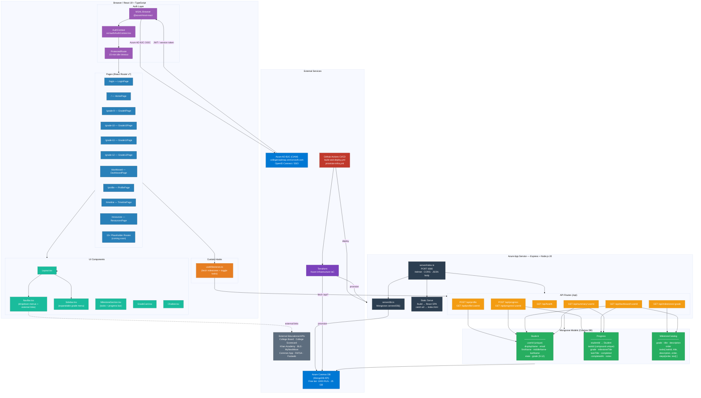

# College Roadmap — Architecture

## Layer Summary

| Layer | Technology | Key detail |
|---|---|---|
| **Frontend** | React 19 + TypeScript + React Router v7 | 10 active pages, 15 placeholder routes, `useMilestones` hook drives all task data |
| **Auth** | MSAL React → Azure AD B2C (OIDC) | JWT stored in sessionStorage, 15-min idle timeout enforced by `ProtectedRoute` |
| **Backend** | Express 4 + Node.js 20 on Azure App Service | 6 route families; also serves the React SPA as static files via catch-all |
| **Database** | Mongoose → Azure Cosmos DB (MongoDB API) | 3 collections: `Student`, `Progress`, `MilestoneCatalog` (seeded with 4-grade catalog) |
| **Infra / CI/CD** | Terraform + GitHub Actions | Build → artifact → Azure deploy; infra provisioned separately via Terraform |
| **External links** | No API calls — NavBar links only | College Board, Khan Academy, BLS, FAFSA, etc. open in browser tabs |
